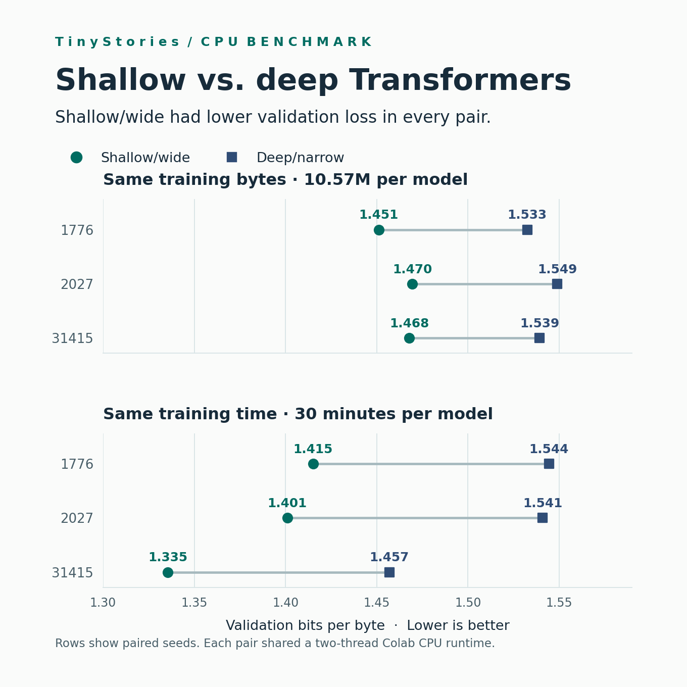

# Shallow vs. deep Transformers on CPU

Do two similarly sized byte-level Transformers rank the same on TinyStories when given equal training bytes and equal CPU training time? In this three-seed benchmark, the shallow/wide model had lower held-out loss in every pair under both budgets.

## Results

Validation loss is reported in bits per byte. Lower is better.

| Seed | CPU | Same bytes, shallow/wide | Same bytes, deep/narrow | Same time, shallow/wide | Same time, deep/narrow |
| --- | --- | ---: | ---: | ---: | ---: |
| 1776 | Intel Xeon | 1.451 | 1.533 | 1.415 | 1.544 |
| 2027 | Intel Xeon | 1.470 | 1.549 | 1.401 | 1.541 |
| 31415 | AMD EPYC | 1.468 | 1.539 | 1.335 | 1.457 |
| Mean | | 1.463 | 1.540 | 1.384 | 1.514 |

Mean validation loss was **5.0% lower at 10,567,680 processed bytes** and **8.6% lower at 30 minutes of measured training** for shallow/wide. Each percentage divides the difference between the two means by the deep/narrow mean. The shallow/wide model also processed more bytes at the time cutoff in all three pairs.

## Experimental setup

| Model | Layers | Width | Attention heads | Trainable parameters |
| --- | ---: | ---: | ---: | ---: |
| Shallow/wide | 3 | 96 | 6 | 357,024 |
| Deep/narrow | 7 | 64 | 4 | 361,408 |

Both models used PyTorch, 256 byte values, context length 128, batches of 8, bias-free causal attention, RMSNorm, rotary positions, a 4× GELU feed-forward expansion, and tied input and output embeddings. AdamW used a fixed learning rate of 0.0003 and the same optimizer settings for both models. The parameter counts differ by about 1.2%, and the notebook checks both counts before training.

Within a seed, the models used the same batch order, fixed validation slice of 130,048 predicted bytes, and the same free Colab CPU runtime with two PyTorch threads. The 30-minute checkpoint is the first fully completed training step at or after 1,800 measured seconds. The step clock includes batch preparation, forward pass, loss, backward pass, and optimizer update. Setup, checkpoint writes, and validation are outside the step clock. Each row of the CSV reports the exact measured seconds.

The code downloads prefixes from the pinned [TinyStories dataset](https://huggingface.co/datasets/roneneldan/TinyStories/tree/f54c09fd23315a6f9c86f9dc80f725de7d8f9c64) and verifies SHA-256 hashes. TinyStories is by Ronen Eldan and Yuanzhi Li. See the [paper](https://arxiv.org/abs/2305.07759) and [dataset card](https://huggingface.co/datasets/roneneldan/TinyStories) for credit and dataset terms. The dataset card lists CDLA-Sharing-1.0. This repository contains experiment code and measurements.

## Reproduce

- **Audit the saved numbers.** Run `python analyze_results.py` to check the notebook output and regenerate [measurements.csv](results/measurements.csv). Run `python analyze_results.py --chart` with `matplotlib` installed to regenerate the chart. The base audit uses the Python standard library. Bytes per training second are the observed checkpoint byte count divided by its measured training seconds.
- **Repeat a matched pair.** Upload [reproduce.ipynb](reproduce.ipynb) into a fresh Colab CPU runtime and select **Run all**. The default seed is 1776, which takes about one hour of measured training across both models, plus setup and evaluation. Set `SELECTED_SEEDS = (1776, 2027, 31415)` to run all pairs. The recorded runs used PyTorch 2.14.1+cpu. Hosted CPU performance varies. A slower runtime can miss the equal-byte checkpoint within the time budget. The notebook verifies the runtime and thread configuration within each pair.
- **Inspect the original evidence.** [colab-output.log](results/colab-output.log) contains the completed training outputs. It has the run metadata, model parameter checks, progress records, exact scores, and matched-pair records.

## Limits and context

These results cover two configurations, one TinyStories slice, three seeds, and the stated CPU budgets. The first two seeds ran on Intel Xeon hardware and the third on AMD EPYC, so seed and CPU changes are confounded across runtimes. The models differ jointly in depth and width. The sample is too small for a general claim about architecture performance. Related projects also explore tiny model shape, including the [ANRGUSC Tiny Language Models project](https://github.com/ANRGUSC/tlm26).

Independent portfolio project by **Omar Borish**. AI tools assisted with the experiment implementation, execution, and write-up.

